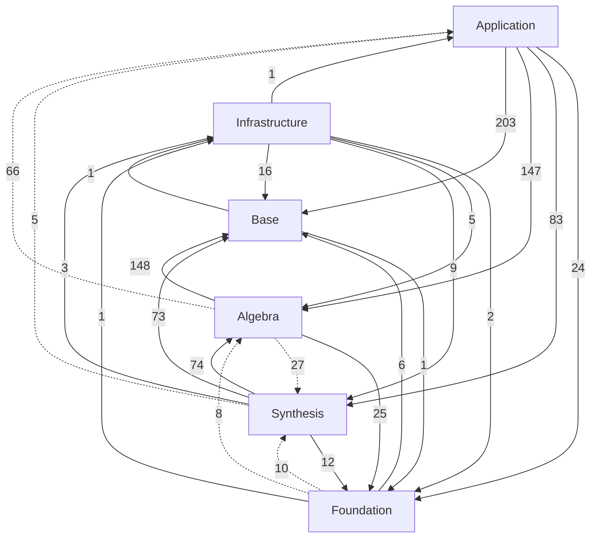
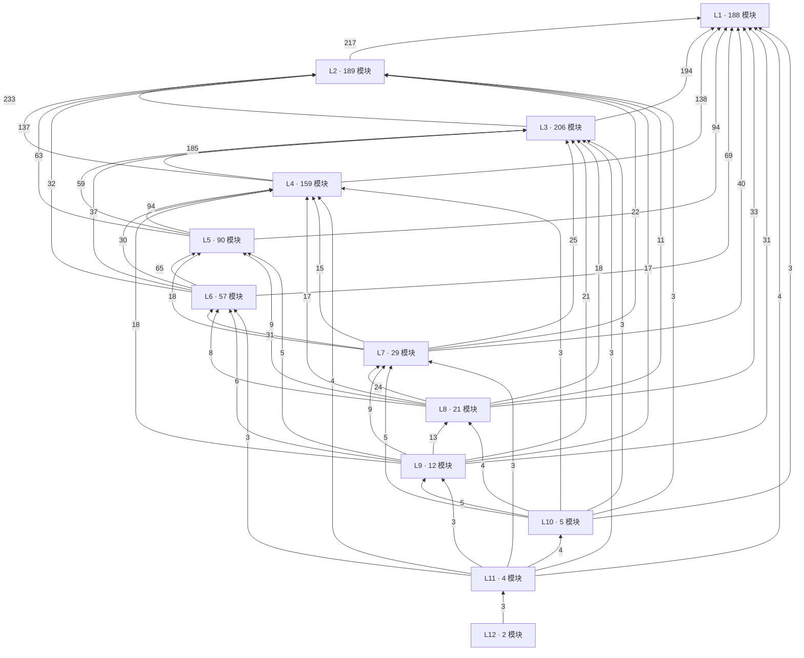
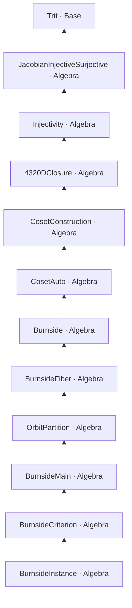

# 模块依赖-import12层

> ⚠️ 本文档是**第三种口径**（import 图），不替代：
> - `docs/课题依赖DAG.{md,yaml,json}`（课题语义 DAG）
> - `proof_dag` 台账（回执）
>
> **用途**：并行调度——12 层是 import 链深度，**不是**数学抽象层级。
> **116 条向上依赖**是测量事实，不等于缺陷；处置需逐条裁决，本文档只列事实。

> 生成脚本：`scripts/dep-levels.py`（层级数据：`_build/verify/levels.txt`）
> 重新生成：`python3 scripts/dep-levels.py`

> 抽象层级以 `AGENTS.md` 的声明为准：`Foundation` 与 `Base` 同为 L0 原语层（互相 import 不算逆序）→ `Algebra`(L2) → `Synthesis`(L3) → `Application`(L4)；`Infrastructure` 是跨切带，声明上豁免 import 单调性。
>
> 语义侧（展示群 / 八要素 / 本源-投影）不在本文范围，权威件见 `docs/maps/八要素统一形状-2026-10-14.md` 与 `docs/课题依赖DAG.md`。
>
> 统计范围：`src/` 下**受版本控制**的 962 个模块；`pn-proofs/`、`probes/` 是 gitignore 草稿，不计。

## 0. 三种「层级」不要混用

| 口径 | 产物/位置 | 回答什么问题 |
|---|---|---|
| **课题依赖 DAG** | `docs/课题依赖DAG.{md,yaml,json}` | 研究课题之间谁先谁后（L0 基座 → A/B/C/D 类），语义口径 |
| **proof_dag 台账** | `proof_dag` 工具（search/check/journal） | 哪个符号已证、证据在哪（回执口径） |
| **import 深度层** | 本文档 | 编译调度：同层无依赖 ⇒ 可并行；**不是**数学抽象层级 |

## 1. 结论先说：12 层 ≠ 12 级抽象

- 声明抽象层只有 **4 级**（+ 1 个跨切带）；import 图实测最深 **12 层**。
- 差异来自**同区文件拆分链**，不是跨区叠层：
  - `Foundation`：36 条内部 import，其中同区 11 条（30%），跨区 25 条。
  - `Base`：6 条内部 import，其中同区 4 条（66%），跨区 2 条。
  - `Algebra`：692 条内部 import，其中同区 426 条（61%），跨区 266 条。
  - `Synthesis`：639 条内部 import，其中同区 472 条（73%），跨区 167 条。
  - `Application`：691 条内部 import，其中同区 234 条（33%），跨区 457 条。
- 最长链（`Sovereign.Algebra.GroupTheory.BurnsideInstance`，12 个模块）的区域序列：

```
Algebra → Algebra → Algebra → Algebra → Algebra → Algebra → Algebra → Algebra → Algebra → Algebra → Algebra → Base
```

  链的构成（按子专题）：`src/Sovereign/Algebra/GroupTheory` 8、`src/Sovereign/Algebra/Jacobian` 2、`src/Sovereign/Algebra/Holographic` 1、`Base` 1。

  即：这条链**跨 4 个子专题**串起来，每个子专题自己又被拆成若干文件
  （Burnside 一族 6 个、Coset 2 个、Jacobian 2 个），末跳才落到 `Base.Trit`。
  ⇒ 深度来自「同区文件拆分 × 跨子专题串联」，不是 12 阶数学抽象。

## 2. 每层模块数 + 抽象层构成

| import 层 | 模块数 | Foundation | Base | Infrastructure | Algebra | Synthesis | Application |
|---|---:|---:|---:|---:|---:|---:|---:|
| L1 | 188 | 19 | 12 | 12 | 53 | 52 | 40 |
| L2 | 189 | 6 | 5 | 4 | 60 | 51 | 63 |
| L3 | 206 | 3 |  | 5 | 78 | 63 | 57 |
| L4 | 159 | 2 |  | 4 | 60 | 27 | 66 |
| L5 | 90 | 1 |  |  | 27 | 24 | 38 |
| L6 | 57 |  |  | 1 | 12 | 17 | 27 |
| L7 | 29 | 1 |  |  | 6 | 16 | 6 |
| L8 | 21 |  |  |  | 4 | 12 | 5 |
| L9 | 12 |  |  |  | 2 | 6 | 4 |
| L10 | 5 |  |  |  | 1 | 3 | 1 |
| L11 | 4 |  |  |  | 3 |  | 1 |
| L12 | 2 |  |  |  | 2 |  |  |

读法：L1 是「不依赖仓库内任何模块」的叶子（却已横跨 6 个区——说明**区域名不是深度**）；
越往上越窄，说明深层链集中在少数专题（群论、Jacobian、A4、拓扑）。

## 3. 区域依赖矩阵（行 = 谁 import，列 = 被 import）

| 从 \ 到 | Foundation | Base | Infrastructure | Algebra | Synthesis | Application |
|---|---:|---:|---:|---:|---:|---:|
| **Foundation** | 11 | 6 | 1 | 8 | 10 |  |
| **Base** | 1 | 4 | 1 |  |  |  |
| **Infrastructure** | 2 | 16 | 8 | 5 | 9 | 1 |
| **Algebra** | 25 | 148 |  | 426 | 27 | 66 |
| **Synthesis** | 12 | 73 | 3 | 74 | 472 | 5 |
| **Application** | 24 | 203 |  | 147 | 83 | 234 |

### 3.1 向上依赖（导入**更高**层；`Infrastructure` 按声明豁免）

| 方向 | 边数 | 例 |
|---|---:|---|
| `Algebra` → `Application` | 66 | `src/Sovereign/Algebra/Analytic/PlancherelTheorem.agda:51` |
| `Algebra` → `Synthesis` | 27 | `src/Sovereign/Algebra/Analytic/DegenerationRisk.agda:83` |
| `Foundation` → `Synthesis` | 10 | `src/Sovereign/Foundation/Boundaries.agda:32` |
| `Foundation` → `Algebra` | 8 | `src/Sovereign/Foundation/CompletenessTheorem.agda:61` |
| `Synthesis` → `Application` | 5 | `src/Sovereign/Synthesis/Analysis/KerTrivial.agda:28` |
| **合计** | **116** | |

> 这些是**按 `AGENTS.md` 声明判**的向上边，不等于错误：有些 `Application/` 子目录实际承担
> 库角色（如 `Application/Algebra/`），或专题跨区复用了证明件。要处置须逐条裁决，本文只列事实。
> 逐条裁决是**另一个任务**（可另建 `docs/maps/向上依赖-裁决清单.md`），不是本文件的前提。

## 4. 依赖图（Mermaid）

### 4.1 区域级（虚线 = 向上依赖）



### 4.2 import 层聚合（节点 = 层，边 = 跨层 import 条数，只画 ≥3 条的）



### 4.3 最长链（11 跳）



## 5. 逐层清单（全部 962 个模块）

### L1（188 个：Foundation 19、Base 12、Infrastructure 12、Algebra 53、Synthesis 52、Application 40）

- `src/Sovereign/Algebra/Analytic/DiscreteSpecialFunctions.agda`
- `src/Sovereign/Algebra/Analytic/DiscreteVariational.agda`
- `src/Sovereign/Algebra/Analytic/Hyperoperation.agda`
- `src/Sovereign/Algebra/Analytic/ProbabilityAddition.agda`
- `src/Sovereign/Algebra/Analytic/SpecialValues.agda`
- `src/Sovereign/Algebra/Analytic/SymmetricFunctions.agda`
- `src/Sovereign/Algebra/Analytic/Tetration.agda`
- `src/Sovereign/Algebra/Automata/DFA.agda`
- `src/Sovereign/Algebra/Automata/RegularGrammar.agda`
- `src/Sovereign/Algebra/Automata/TuringMachine.agda`
- `src/Sovereign/Algebra/Combinatorics/Counting.agda`
- `src/Sovereign/Algebra/Combinatorics/Designs.agda`
- `src/Sovereign/Algebra/Combinatorics/DivisorLattice.agda`
- `src/Sovereign/Algebra/Combinatorics/Permutations.agda`
- `src/Sovereign/Algebra/Combinatorics/RootCount.agda`
- `src/Sovereign/Algebra/FieldTower/FieldExtensionTower.agda`
- `src/Sovereign/Algebra/FieldTower/SovereignLCMRoots.agda`
- `src/Sovereign/Algebra/FieldTower/SpiralCycle.agda`
- `src/Sovereign/Algebra/FieldTower/ZhengFu.agda`
- `src/Sovereign/Algebra/GroupTheory/BraidGroup.agda`
- `src/Sovereign/Algebra/GroupTheory/BurauFaithful.agda`
- `src/Sovereign/Algebra/GroupTheory/C3Orbit.agda`
- `src/Sovereign/Algebra/GroupTheory/DayanCRT.agda`
- `src/Sovereign/Algebra/GroupTheory/DayanCompose.agda`
- `src/Sovereign/Algebra/GroupTheory/DayanCorrectZ.agda`
- `src/Sovereign/Algebra/GroupTheory/DayanInvariant.agda`
- `src/Sovereign/Algebra/GroupTheory/DayanProof.agda`
- `src/Sovereign/Algebra/GroupTheory/DayanState.agda`
- `src/Sovereign/Algebra/GroupTheory/FaddeevYangBaxter.agda`
- `src/Sovereign/Algebra/GroupTheory/Word.agda`
- `src/Sovereign/Algebra/Jacobian/Hensel3Side.agda`
- `src/Sovereign/Algebra/Jacobian/HenselLiftMinimal.agda`
- `src/Sovereign/Algebra/Jacobian/HenselLiftTower.agda`
- `src/Sovereign/Algebra/LinearAlgebra/CartanMatrix.agda`
- `src/Sovereign/Algebra/LinearAlgebra/GF3HammingCount.agda`
- `src/Sovereign/Algebra/LinearAlgebra/GF3MonoCount.agda`
- `src/Sovereign/Algebra/LinearAlgebra/Matrix2.agda`
- `src/Sovereign/Algebra/NumberTheory/DigitalRootCycle.agda`
- `src/Sovereign/Algebra/NumberTheory/Divisibility.agda`
- `src/Sovereign/Algebra/NumberTheory/FangCheng.agda`
- `src/Sovereign/Algebra/NumberTheory/KaiFang.agda`
- `src/Sovereign/Algebra/NumberTheory/ModExtract.agda`
- `src/Sovereign/Algebra/NumberTheory/NumberTheoryAnchors.agda`
- `src/Sovereign/Algebra/NumberTheory/Primes.agda`
- `src/Sovereign/Algebra/NumberTheory/ProbeArith.agda`
- `src/Sovereign/Algebra/NumberTheory/SunyiBase.agda`
- `src/Sovereign/Algebra/Representation/Maschke.agda`
- `src/Sovereign/Algebra/RingTheory/DescendingChain.agda`
- `src/Sovereign/Algebra/RingTheory/DivisibilityChain.agda`
- `src/Sovereign/Algebra/RingTheory/LaurentBase.agda`
- `src/Sovereign/Algebra/RingTheory/LaurentFn.agda`
- `src/Sovereign/Algebra/RingTheory/LaurentPolynomial.agda`
- `src/Sovereign/Algebra/UniversalAlgebra/KacMoodyAlgebra.agda`
- `src/Sovereign/Application/Algebra/AlphaRelation.agda`
- `src/Sovereign/Application/Algebra/ChainComplex.agda`
- `src/Sovereign/Application/Algebra/GL2TestVectors.agda`
- `src/Sovereign/Application/Analysis/EulerChar.agda`
- `src/Sovereign/Application/Analysis/GoodnessOfFitGF3.agda`
- `src/Sovereign/Application/Analysis/RandomMatrixMoments.agda`
- `src/Sovereign/Application/Analysis/UniformProb.agda`
- `src/Sovereign/Application/CrossDomain/PacketShiftArithmetic.agda`
- `src/Sovereign/Application/Geometry/ConformalInvariants.agda`
- `src/Sovereign/Application/Geometry/ProjectiveTransformHFM.agda`
- `src/Sovereign/Application/Morse/FormanChiInvariant.agda`
- `src/Sovereign/Application/Physics/AcousticsDiscrete.agda`
- `src/Sovereign/Application/Physics/DiscreteEMField.agda`
- `src/Sovereign/Application/Physics/DiscreteEMField3D.agda`
- `src/Sovereign/Application/Physics/EntropySpin.agda`
- `src/Sovereign/Application/Physics/InformationEntropy.agda`
- `src/Sovereign/Application/Physics/KirchhoffZ.agda`
- `src/Sovereign/Application/Physics/Scaling.agda`
- `src/Sovereign/Application/Physics/ThermoExtended.agda`
- `src/Sovereign/Application/Physics/TracelessCentroidZero.agda`
- `src/Sovereign/Application/Problems/ABC/L1Rad.agda`
- `src/Sovereign/Application/Problems/BSD/BSDTrace.agda`
- `src/Sovereign/Application/Problems/BSD/BSD_GF243.agda`
- `src/Sovereign/Application/Problems/BSD/BSD_GF27.agda`
- `src/Sovereign/Application/Problems/BSD/BSD_GF81.agda`
- `src/Sovereign/Application/Problems/BSD/BSD_General.agda`
- `src/Sovereign/Application/Problems/BSD/BSD_L3.agda`
- `src/Sovereign/Application/Problems/Hodge/HodgeTetra.agda`
- `src/Sovereign/Application/Problems/Hodge/Hodge_L3.agda`
- `src/Sovereign/Application/Problems/Hodge/KleinHodge.agda`
- `src/Sovereign/Application/Problems/Hodge/TorusHodge.agda`
- `src/Sovereign/Application/Problems/Langlands/GL2_Rep.agda`
- `src/Sovereign/Application/Problems/Langlands/Langlands.agda`
- `src/Sovereign/Application/Problems/Langlands/Langlands_L15.agda`
- `src/Sovereign/Application/Problems/Langlands/S4Burnside.agda`
- `src/Sovereign/Application/Problems/PvsNP/PvsNP_Conjecture.agda`
- `src/Sovereign/Application/Problems/RH/WeilRH.agda`
- `src/Sovereign/Application/Problems/Sqrt2/Sqrt2Irrational.agda`
- `src/Sovereign/Application/Problems/YangMills/ObservabilityAngle.agda`
- `src/Sovereign/Application/Topology/MorseRoute.agda`
- `src/Sovereign/Base/Coding/Trit.agda`
- `src/Sovereign/Base/Fin3.agda`
- `src/Sovereign/Base/Fin3Sum9.agda`
- `src/Sovereign/Base/FunctionTheory.agda`
- `src/Sovereign/Base/IntArith.agda`
- `src/Sovereign/Base/Invariants.agda`
- `src/Sovereign/Base/Lü.agda`
- `src/Sovereign/Base/MobiusPhi.agda`
- `src/Sovereign/Base/PairEnc.agda`
- `src/Sovereign/Base/Trit.agda`
- `src/Sovereign/Base/Untrusted.agda`
- `src/Sovereign/Base/WuXing.agda`
- `src/Sovereign/Foundation/AlgebraicComplex.agda`
- `src/Sovereign/Foundation/Arithmetic.agda`
- `src/Sovereign/Foundation/Axioms.agda`
- `src/Sovereign/Foundation/Base.agda`
- `src/Sovereign/Foundation/DigitalRoot.agda`
- `src/Sovereign/Foundation/Eisenstein.agda`
- `src/Sovereign/Foundation/Equiv.agda`
- `src/Sovereign/Foundation/FiniteDynamics.agda`
- `src/Sovereign/Foundation/FiniteModelTheory.agda`
- `src/Sovereign/Foundation/Finiteness/Pigeonhole.agda`
- `src/Sovereign/Foundation/FirstHit.agda`
- `src/Sovereign/Foundation/Gaussian.agda`
- `src/Sovereign/Foundation/Layer.agda`
- `src/Sovereign/Foundation/LogicDecidable.agda`
- `src/Sovereign/Foundation/PhysicalAssumptions.agda`
- `src/Sovereign/Foundation/PropositionalLogic.agda`
- `src/Sovereign/Foundation/QuotientBasic.agda`
- `src/Sovereign/Foundation/RelationClosures.agda`
- `src/Sovereign/Foundation/WellFounded.agda`
- `src/Sovereign/Infrastructure/AlgebraWrapper.agda`
- `src/Sovereign/Infrastructure/External.agda`
- `src/Sovereign/Infrastructure/Integration.agda`
- `src/Sovereign/Infrastructure/KernelWitness.agda`
- `src/Sovereign/Infrastructure/PatchedTypeChecker.agda`
- `src/Sovereign/Infrastructure/PresentationGapBoundary.agda`
- `src/Sovereign/Infrastructure/Projection.agda`
- `src/Sovereign/Infrastructure/Projection/Decimal/Axioms.agda`
- `src/Sovereign/Infrastructure/ReductionGapObservation.agda`
- `src/Sovereign/Infrastructure/ReductionGapWitness.agda`
- `src/Sovereign/Infrastructure/TwoViewPlain.agda`
- `src/Sovereign/Infrastructure/TwoViewRewritten.agda`
- `src/Sovereign/Synthesis/A4/A4Group.agda`
- `src/Sovereign/Synthesis/A4/A4Orbits3.agda`
- `src/Sovereign/Synthesis/A4/A4Representation.agda`
- `src/Sovereign/Synthesis/A4/BinaryTetrahedral.agda`
- `src/Sovereign/Synthesis/A4/BinaryTetrahedralHFM.agda`
- `src/Sovereign/Synthesis/A4/T6A4Burnside.agda`
- `src/Sovereign/Synthesis/Analysis/ApproxBounds.agda`
- `src/Sovereign/Synthesis/Analysis/DefectSum.agda`
- `src/Sovereign/Synthesis/Analysis/DiscreteMeasure.agda`
- `src/Sovereign/Synthesis/Analysis/PhaseTransitionPaths.agda`
- `src/Sovereign/Synthesis/CRT/CRTHarmonics.agda`
- `src/Sovereign/Synthesis/CRT/M4CRTBridge.agda`
- `src/Sovereign/Synthesis/CRT/XuanwuAbsorptionRewrite.agda`
- `src/Sovereign/Synthesis/Combinatorics/MagicSquareHFM.agda`
- `src/Sovereign/Synthesis/Combinatorics/OrthogonalLatinSquare.agda`
- `src/Sovereign/Synthesis/Combinatorics/PhaseAlignment6624.agda`
- `src/Sovereign/Synthesis/Combinatorics/PickTheorem.agda`
- `src/Sovereign/Synthesis/Combinatorics/T6Rewrite.agda`
- `src/Sovereign/Synthesis/Combinatorics/TorusClosure.agda`
- `src/Sovereign/Synthesis/DiscreteCubical/Path.agda`
- `src/Sovereign/Synthesis/FieldTower/GF4.agda`
- `src/Sovereign/Synthesis/FieldTower/Zωi.agda`
- `src/Sovereign/Synthesis/Format/DiscreteCubical.agda`
- `src/Sovereign/Synthesis/Format/Positional.agda`
- `src/Sovereign/Synthesis/Geometry/ProjPlane.agda`
- `src/Sovereign/Synthesis/Graphs/RamseyFinite.agda`
- `src/Sovereign/Synthesis/Homotopy/BarceloAHomotopy.agda`
- `src/Sovereign/Synthesis/Homotopy/HomologicalAlgebra.agda`
- `src/Sovereign/Synthesis/Homotopy/PigeonholeStandard.agda`
- `src/Sovereign/Synthesis/Homotopy/T6CayleyCode.agda`
- `src/Sovereign/Synthesis/Model/DiscreteCCHM.agda`
- `src/Sovereign/Synthesis/NumberTheory/AtkinQ1.agda`
- `src/Sovereign/Synthesis/NumberTheory/AtkinQAnalysis.agda`
- `src/Sovereign/Synthesis/NumberTheory/DigitField.agda`
- `src/Sovereign/Synthesis/NumberTheory/FinMixedRadix.agda`
- `src/Sovereign/Synthesis/NumberTheory/HammingMetric.agda`
- `src/Sovereign/Synthesis/NumberTheory/Winding.agda`
- `src/Sovereign/Synthesis/Physics/AxialNoSplit.agda`
- `src/Sovereign/Synthesis/Physics/IhC60Vibration.agda`
- `src/Sovereign/Synthesis/Physics/NoSplitJ1.agda`
- `src/Sovereign/Synthesis/Physics/NoSplitJ1Full.agda`
- `src/Sovereign/Synthesis/Physics/PolyhedralReps.agda`
- `src/Sovereign/Synthesis/Physics/PyBitNetGF9Rigidity.agda`
- `src/Sovereign/Synthesis/Physics/PyBitNetPresentationCheck.agda`
- `src/Sovereign/Synthesis/Physics/S6EFGAxial.agda`
- `src/Sovereign/Synthesis/Physics/SP2Ternary.agda`
- `src/Sovereign/Synthesis/Physics/TRMultipletsZ.agda`
- `src/Sovereign/Synthesis/Physics/TrainingSoftConstraint.agda`
- `src/Sovereign/Synthesis/Physics/WuXingEulerHFM.agda`
- `src/Sovereign/Synthesis/Topology/AlexandroffFinite.agda`
- `src/Sovereign/Synthesis/Topology/DeRhamComplex.agda`
- `src/Sovereign/Synthesis/Topology/Geometry.agda`

### L2（189 个：Foundation 6、Base 5、Infrastructure 4、Algebra 60、Synthesis 51、Application 63）

- `src/Sovereign/Algebra/Analytic/CalculusOfVariations.agda`
- `src/Sovereign/Algebra/Analytic/DiscreteKTheory.agda`
- `src/Sovereign/Algebra/Analytic/DiscreteSeveralComplex.agda`
- `src/Sovereign/Algebra/Analytic/DiscreteSeveralComplexData.agda`
- `src/Sovereign/Algebra/Analytic/DiscreteVariation.agda`
- `src/Sovereign/Algebra/Analytic/FixedPointQ16.agda`
- `src/Sovereign/Algebra/Analytic/FunctionalDiscrete.agda`
- `src/Sovereign/Algebra/Analytic/IntegrationByParts.agda`
- `src/Sovereign/Algebra/Analytic/ListFunctor.agda`
- `src/Sovereign/Algebra/Analytic/NoetherTheorem.agda`
- `src/Sovereign/Algebra/Automata/TrivialRepUnfaithful.agda`
- `src/Sovereign/Algebra/Combinatorics/GenFunctions.agda`
- `src/Sovereign/Algebra/Combinatorics/Multisets.agda`
- `src/Sovereign/Algebra/Combinatorics/RootCount4.agda`
- `src/Sovereign/Algebra/Combinatorics/RootCountClassify.agda`
- `src/Sovereign/Algebra/FieldTower/GF243.agda`
- `src/Sovereign/Algebra/FieldTower/GF27.agda`
- `src/Sovereign/Algebra/FieldTower/GF2Degeneration.agda`
- `src/Sovereign/Algebra/FieldTower/GF9.agda`
- `src/Sovereign/Algebra/FieldTower/KaiFangSqrt3.agda`
- `src/Sovereign/Algebra/FieldTower/Zomega.agda`
- `src/Sovereign/Algebra/GroupTheory/BraidCongruence.agda`
- `src/Sovereign/Algebra/GroupTheory/BurauCubical.agda`
- `src/Sovereign/Algebra/GroupTheory/DayanCRTGeneric.agda`
- `src/Sovereign/Algebra/GroupTheory/DayanCorrect.agda`
- `src/Sovereign/Algebra/GroupTheory/DayanNatFix.agda`
- `src/Sovereign/Algebra/GroupTheory/DayanTermination.agda`
- `src/Sovereign/Algebra/GroupTheory/Duodecimal.agda`
- `src/Sovereign/Algebra/Holographic/LatticeField.agda`
- `src/Sovereign/Algebra/Holographic/Theorem.agda`
- `src/Sovereign/Algebra/Jacobian/Discrete.agda`
- `src/Sovereign/Algebra/Jacobian/GF3.agda`
- `src/Sovereign/Algebra/Jacobian/Hensel2Side.agda`
- `src/Sovereign/Algebra/Jacobian/HenselLiftUniqueness.agda`
- `src/Sovereign/Algebra/Jacobian/HenselReduction.agda`
- `src/Sovereign/Algebra/Jacobian/Jacobian.agda`
- `src/Sovereign/Algebra/Jacobian/JacobianInjectiveSurjective.agda`
- `src/Sovereign/Algebra/Jacobian/LinearAlgebra.agda`
- `src/Sovereign/Algebra/LinearAlgebra/GF3Count.agda`
- `src/Sovereign/Algebra/LinearAlgebra/GF3LaplacianN.agda`
- `src/Sovereign/Algebra/LinearAlgebra/GF3Rank.agda`
- `src/Sovereign/Algebra/LinearAlgebra/GF3RowOps.agda`
- `src/Sovereign/Algebra/LinearAlgebra/LinearRecurrence.agda`
- `src/Sovereign/Algebra/NumberTheory/TianYuan.agda`
- `src/Sovereign/Algebra/Quantum/NoCloning.agda`
- `src/Sovereign/Algebra/RingTheory/ChainComplex.agda`
- `src/Sovereign/Algebra/RingTheory/CommAlgBridge.agda`
- `src/Sovereign/Algebra/RingTheory/DiscretePolynomial.agda`
- `src/Sovereign/Algebra/RingTheory/ExactSequence.agda`
- `src/Sovereign/Algebra/RingTheory/HomologicalBridge.agda`
- `src/Sovereign/Algebra/RingTheory/HomologyLES.agda`
- `src/Sovereign/Algebra/RingTheory/LaurentCanon.agda`
- `src/Sovereign/Algebra/RingTheory/LaurentCubical.agda`
- `src/Sovereign/Algebra/RingTheory/LaurentDistrib.agda`
- `src/Sovereign/Algebra/RingTheory/LaurentPolynomialFull.agda`
- `src/Sovereign/Algebra/RingTheory/Polynomials.agda`
- `src/Sovereign/Algebra/RingTheory/Ring3pow11.agda`
- `src/Sovereign/Algebra/RingTheory/SunyiChain.agda`
- `src/Sovereign/Algebra/UniversalAlgebra/FreeAb.agda`
- `src/Sovereign/Algebra/UniversalAlgebra/ListLaws.agda`
- `src/Sovereign/Application/Algebra/CubicRoot.agda`
- `src/Sovereign/Application/Algebra/CubicRootTest.agda`
- `src/Sovereign/Application/Algebra/Tryte.agda`
- `src/Sovereign/Application/Analysis/DiscreteCR.agda`
- `src/Sovereign/Application/Analysis/DiscreteIntegralEq.agda`
- `src/Sovereign/Application/Analysis/DiscretePotential.agda`
- `src/Sovereign/Application/Analysis/DiscreteProbability.agda`
- `src/Sovereign/Application/Analysis/EulerPoincareInstance.agda`
- `src/Sovereign/Application/Analysis/FiniteOrbitObs.agda`
- `src/Sovereign/Application/Analysis/FiniteProbability.agda`
- `src/Sovereign/Application/CrossDomain/BiologyDiscrete.agda`
- `src/Sovereign/Application/CrossDomain/ControlTheory.agda`
- `src/Sovereign/Application/CrossDomain/DomainProofs.agda`
- `src/Sovereign/Application/CrossDomain/EconomicsDiscrete.agda`
- `src/Sovereign/Application/CrossDomain/GameTheory.agda`
- `src/Sovereign/Application/CrossDomain/GeneticsExtended.agda`
- `src/Sovereign/Application/CrossDomain/NeuroscienceDiscrete.agda`
- `src/Sovereign/Application/CrossDomain/OptimizationDiscrete.agda`
- `src/Sovereign/Application/Geometry/AlgGeom.agda`
- `src/Sovereign/Application/Geometry/DiscreteManifold.agda`
- `src/Sovereign/Application/Morse/FormanMinimal.agda`
- `src/Sovereign/Application/Morse/MorseCoeffLaws.agda`
- `src/Sovereign/Application/Morse/MorsePartialG.agda`
- `src/Sovereign/Application/Morse/MorseRouteListG.agda`
- `src/Sovereign/Application/Morse/MorseSqZeroG.agda`
- `src/Sovereign/Application/Morse/MorseSqZeroK3.agda`
- `src/Sovereign/Application/Morse/SoftModeCriticality.agda`
- `src/Sovereign/Application/Physics/CelestialExtended.agda`
- `src/Sovereign/Application/Physics/DataAnchors.agda`
- `src/Sovereign/Application/Physics/DiscreteDiffOps.agda`
- `src/Sovereign/Application/Physics/DiscreteEMCore.agda`
- `src/Sovereign/Application/Physics/DiscreteLightcone.agda`
- `src/Sovereign/Application/Physics/DiscreteStatMech.agda`
- `src/Sovereign/Application/Physics/ElasticityDiscrete.agda`
- `src/Sovereign/Application/Physics/EntropySpinLaw.agda`
- `src/Sovereign/Application/Physics/FineStructureMapping.agda`
- `src/Sovereign/Application/Physics/FluidDiscrete.agda`
- `src/Sovereign/Application/Physics/H2OC60.agda`
- `src/Sovereign/Application/Physics/IsingTriangle.agda`
- `src/Sovereign/Application/Physics/MolecularSymmetry.agda`
- `src/Sovereign/Application/Physics/NeutrinoFlavorGF3.agda`
- `src/Sovereign/Application/Physics/OpticsDiscrete.agda`
- `src/Sovereign/Application/Physics/ProbThermo.agda`
- `src/Sovereign/Application/Problems/ABC/L1Disjunction.agda`
- `src/Sovereign/Application/Problems/BSD/BSD.agda`
- `src/Sovereign/Application/Problems/BSD/EllipticComplex.agda`
- `src/Sovereign/Application/Problems/FLT/FermatL0.agda`
- `src/Sovereign/Application/Problems/Hodge/FormanMorseInequality.agda`
- `src/Sovereign/Application/Problems/Kakeya/KakeyaGF3.agda`
- `src/Sovereign/Application/Problems/NavierStokes/CondensedMatter.agda`
- `src/Sovereign/Application/Problems/NavierStokes/NSE.agda`
- `src/Sovereign/Application/Problems/NavierStokes/NSEOnT6.agda`
- `src/Sovereign/Application/Problems/NavierStokes/NSEOnT6SixAxis.agda`
- `src/Sovereign/Application/Problems/NavierStokes/NSVortex.agda`
- `src/Sovereign/Application/Problems/PvsNP/Algorithm.agda`
- `src/Sovereign/Application/Problems/PvsNP/Complexity3.agda`
- `src/Sovereign/Application/Problems/PvsNP/GF27Separation.agda`
- `src/Sovereign/Application/Problems/PvsNP/PvsNP_Separation.agda`
- `src/Sovereign/Application/Problems/RH/FrobeniusBlind.agda`
- `src/Sovereign/Application/Problems/RH/WeilRigidity.agda`
- `src/Sovereign/Application/Problems/Sqrt2/Sqrt2Valuation.agda`
- `src/Sovereign/Application/Problems/YangMills/EckmannGF3.agda`
- `src/Sovereign/Application/Problems/YangMills/SU2_Embedding.agda`
- `src/Sovereign/Base/Axioms.agda`
- `src/Sovereign/Base/CRTLemmas.agda`
- `src/Sovereign/Base/Nayin.agda`
- `src/Sovereign/Base/TritOps.agda`
- `src/Sovereign/Base/ZeroGeometry.agda`
- `src/Sovereign/Foundation/DigitalRootClassic.agda`
- `src/Sovereign/Foundation/EnergyGap.agda`
- `src/Sovereign/Foundation/Finiteness/Foundations.agda`
- `src/Sovereign/Foundation/Finiteness/Tarski.agda`
- `src/Sovereign/Foundation/FunctorProof.agda`
- `src/Sovereign/Foundation/GaoYangRigidLock.agda`
- `src/Sovereign/Infrastructure/GuardedVsPresentation.agda`
- `src/Sovereign/Infrastructure/Projection/Binary.agda`
- `src/Sovereign/Infrastructure/Projection/Decimal/Proofs.agda`
- `src/Sovereign/Infrastructure/TwoViews.agda`
- `src/Sovereign/Synthesis/A4/A4GenWords.agda`
- `src/Sovereign/Synthesis/A4/A4StdlibBridge.agda`
- `src/Sovereign/Synthesis/A4/BinaryTetrahedralRepresentation.agda`
- `src/Sovereign/Synthesis/A4/CarrierA4.agda`
- `src/Sovereign/Synthesis/A4/TetrahedralA4.agda`
- `src/Sovereign/Synthesis/Analysis/DifferenceEq.agda`
- `src/Sovereign/Synthesis/Analysis/DiscreteApprox.agda`
- `src/Sovereign/Synthesis/Analysis/NumericalSpec.agda`
- `src/Sovereign/Synthesis/Analysis/Paths.agda`
- `src/Sovereign/Synthesis/CRT/CanonicityAlignment.agda`
- `src/Sovereign/Synthesis/CRT/LossGain.agda`
- `src/Sovereign/Synthesis/Combinatorics/DynamicMagicSquare.agda`
- `src/Sovereign/Synthesis/Combinatorics/GF4AffineMagicSquare.agda`
- `src/Sovereign/Synthesis/Combinatorics/LuCellGrid.agda`
- `src/Sovereign/Synthesis/Combinatorics/OrderLattice.agda`
- `src/Sovereign/Synthesis/Combinatorics/OrthogonalLatinSquareGF4.agda`
- `src/Sovereign/Synthesis/Combinatorics/T6.agda`
- `src/Sovereign/Synthesis/Combinatorics/VectorDirection.agda`
- `src/Sovereign/Synthesis/FieldTower/MatrixZω.agda`
- `src/Sovereign/Synthesis/FieldTower/S3IsGL22.agda`
- `src/Sovereign/Synthesis/Format/Doz.agda`
- `src/Sovereign/Synthesis/Format/FFIProtocol.agda`
- `src/Sovereign/Synthesis/Format/ParityViolation.agda`
- `src/Sovereign/Synthesis/Geometry/ChernClass.agda`
- `src/Sovereign/Synthesis/Geometry/FrequencySpaceUnity.agda`
- `src/Sovereign/Synthesis/Graphs/GraphBasic.agda`
- `src/Sovereign/Synthesis/Homotopy/AStepStd.agda`
- `src/Sovereign/Synthesis/Homotopy/Bundle.agda`
- `src/Sovereign/Synthesis/Homotopy/C5Rigidity.agda`
- `src/Sovereign/Synthesis/Homotopy/DoubleTriangle.agda`
- `src/Sovereign/Synthesis/Homotopy/Fibration.agda`
- `src/Sovereign/Synthesis/Homotopy/KanComposition.agda`
- `src/Sovereign/Synthesis/Homotopy/McCordCore.agda`
- `src/Sovereign/Synthesis/Homotopy/Omega2.agda`
- `src/Sovereign/Synthesis/Homotopy/Pi1dCardinality.agda`
- `src/Sovereign/Synthesis/Homotopy/Pi1dLoops.agda`
- `src/Sovereign/Synthesis/Homotopy/Pi1dMonoid.agda`
- `src/Sovereign/Synthesis/Homotopy/PostnikovTruncation.agda`
- `src/Sovereign/Synthesis/Homotopy/QAnalysisRecord.agda`
- `src/Sovereign/Synthesis/Homotopy/T6AStepCode.agda`
- `src/Sovereign/Synthesis/Homotopy/T6CayleyGraph.agda`
- `src/Sovereign/Synthesis/Homotopy/WalkTransport.agda`
- `src/Sovereign/Synthesis/NumberTheory/LCM.agda`
- `src/Sovereign/Synthesis/Physics/EnergyGap.agda`
- `src/Sovereign/Synthesis/Physics/IhGroup.agda`
- `src/Sovereign/Synthesis/Physics/J1MatricesProbe.agda`
- `src/Sovereign/Synthesis/Physics/NoSplitJ1Ring.agda`
- `src/Sovereign/Synthesis/Physics/TRMultipletsNat.agda`
- `src/Sovereign/Synthesis/Representation/SetoidFreeGroupUniversal.agda`
- `src/Sovereign/Synthesis/Topology/FiniteTopology.agda`
- `src/Sovereign/Synthesis/Topology/HighDimClosure.agda`

### L3（206 个：Foundation 3、Infrastructure 5、Algebra 78、Synthesis 63、Application 57）

- `src/Sovereign/Algebra/Analytic/BCWDegeneracy.agda`
- `src/Sovereign/Algebra/Analytic/CauchySchwarz.agda`
- `src/Sovereign/Algebra/Analytic/DegenerationTaxonomy.agda`
- `src/Sovereign/Algebra/Analytic/FiniteInnerProduct.agda`
- `src/Sovereign/Algebra/Analytic/FunctionalAnalysisDiscrete.agda`
- `src/Sovereign/Algebra/Analytic/IterationTheory.agda`
- `src/Sovereign/Algebra/Analytic/NormCollapse.agda`
- `src/Sovereign/Algebra/Analytic/NormEquivalence.agda`
- `src/Sovereign/Algebra/Analytic/VortexDifferential.agda`
- `src/Sovereign/Algebra/Combinatorics/InjSurj.agda`
- `src/Sovereign/Algebra/Combinatorics/Partitions.agda`
- `src/Sovereign/Algebra/Combinatorics/Pigeonhole.agda`
- `src/Sovereign/Algebra/FieldTower/AlgGeomBridge.agda`
- `src/Sovereign/Algebra/FieldTower/ExponentDimension.agda`
- `src/Sovereign/Algebra/FieldTower/FrobeniusOrbit.agda`
- `src/Sovereign/Algebra/FieldTower/GF81.agda`
- `src/Sovereign/Algebra/FieldTower/GF9AlgebraicChain.agda`
- `src/Sovereign/Algebra/FieldTower/GaloisBridge.agda`
- `src/Sovereign/Algebra/FieldTower/LCMVortexConnection.agda`
- `src/Sovereign/Algebra/FieldTower/TriCycGraph.agda`
- `src/Sovereign/Algebra/FieldTower/TriadicHarmonic.agda`
- `src/Sovereign/Algebra/FieldTower/VortexRoot.agda`
- `src/Sovereign/Algebra/FieldTower/ZeroCrossing.agda`
- `src/Sovereign/Algebra/FieldTower/ZhonglvClosure.agda`
- `src/Sovereign/Algebra/GF9FrobeniusC4.agda`
- `src/Sovereign/Algebra/GroupTheory/BurauRep.agda`
- `src/Sovereign/Algebra/GroupTheory/DuodecClock.agda`
- `src/Sovereign/Algebra/GroupTheory/GaloisTheory.agda`
- `src/Sovereign/Algebra/GroupTheory/Lagrange.agda`
- `src/Sovereign/Algebra/GroupTheory/NormExactSequence.agda`
- `src/Sovereign/Algebra/GroupTheory/NormHomomorphism.agda`
- `src/Sovereign/Algebra/Holographic/4320D.agda`
- `src/Sovereign/Algebra/Holographic/Conjecture.agda`
- `src/Sovereign/Algebra/Jacobian/CRTDet.agda`
- `src/Sovereign/Algebra/Jacobian/GF9Matrix.agda`
- `src/Sovereign/Algebra/Jacobian/HenselCRTSynth.agda`
- `src/Sovereign/Algebra/Jacobian/HenselLiftMod27.agda`
- `src/Sovereign/Algebra/Jacobian/HenselLiftMod27Part1.agda`
- `src/Sovereign/Algebra/Jacobian/HenselLiftMod27Part2.agda`
- `src/Sovereign/Algebra/Jacobian/HenselLiftRoot1.agda`
- `src/Sovereign/Algebra/Jacobian/HenselMod129140163.agda`
- `src/Sovereign/Algebra/Jacobian/HenselMod14348907.agda`
- `src/Sovereign/Algebra/Jacobian/HenselMod1594323.agda`
- `src/Sovereign/Algebra/Jacobian/HenselMod177147.agda`
- `src/Sovereign/Algebra/Jacobian/HenselMod19683.agda`
- `src/Sovereign/Algebra/Jacobian/HenselMod2187.agda`
- `src/Sovereign/Algebra/Jacobian/HenselMod243.agda`
- `src/Sovereign/Algebra/Jacobian/HenselMod43046721.agda`
- `src/Sovereign/Algebra/Jacobian/HenselMod4782969.agda`
- `src/Sovereign/Algebra/Jacobian/HenselMod531441.agda`
- `src/Sovereign/Algebra/Jacobian/HenselMod59049.agda`
- `src/Sovereign/Algebra/Jacobian/HenselMod6561.agda`
- `src/Sovereign/Algebra/Jacobian/HenselMod729.agda`
- `src/Sovereign/Algebra/Jacobian/HenselMod81.agda`
- `src/Sovereign/Algebra/Jacobian/HenselModPow2.agda`
- `src/Sovereign/Algebra/Jacobian/HenselReductionTower.agda`
- `src/Sovereign/Algebra/Jacobian/Injectivity.agda`
- `src/Sovereign/Algebra/Jacobian/Matrix.agda`
- `src/Sovereign/Algebra/Lie/LieAlgebra.agda`
- `src/Sovereign/Algebra/Lie/LieGroup.agda`
- `src/Sovereign/Algebra/LinearAlgebra/AdjacencyMatrix.agda`
- `src/Sovereign/Algebra/LinearAlgebra/GF3Barrier.agda`
- `src/Sovereign/Algebra/LinearAlgebra/GF9KernelImageZero.agda`
- `src/Sovereign/Algebra/LinearAlgebra/LinearFunctionalDiscrete.agda`
- `src/Sovereign/Algebra/LinearAlgebra/SpectralFunctionTheory.agda`
- `src/Sovereign/Algebra/LinearAlgebra/SpectralTheorem.agda`
- `src/Sovereign/Algebra/NumberTheory/Base10Degeneration.agda`
- `src/Sovereign/Algebra/NumberTheory/DiscreteFibonacci.agda`
- `src/Sovereign/Algebra/NumberTheory/ModularArithmetic.agda`
- `src/Sovereign/Algebra/RingTheory/CRTZeroCriterion.agda`
- `src/Sovereign/Algebra/RingTheory/ChainHom.agda`
- `src/Sovereign/Algebra/RingTheory/ChainZ3toZ12.agda`
- `src/Sovereign/Algebra/RingTheory/LaurentMulAssoc.agda`
- `src/Sovereign/Algebra/RingTheory/LaurentNorm.agda`
- `src/Sovereign/Algebra/RingTheory/LaurentRingLaws.agda`
- `src/Sovereign/Algebra/RingTheory/LaurentSort.agda`
- `src/Sovereign/Algebra/RingTheory/ModularRoots.agda`
- `src/Sovereign/Algebra/UniversalAlgebra/UniversalAlgebra.agda`
- `src/Sovereign/Application/Algebra/AlgebraChainDeep.agda`
- `src/Sovereign/Application/Algebra/CharacteristicTower.agda`
- `src/Sovereign/Application/Algebra/Galois.agda`
- `src/Sovereign/Application/Analysis/DiscreteComplexAnalysis.agda`
- `src/Sovereign/Application/Analysis/DiscreteDiffOpsChecks.agda`
- `src/Sovereign/Application/Coding/CyclicGF27.agda`
- `src/Sovereign/Application/Coupling/TQ10.agda`
- `src/Sovereign/Application/CrossDomain/CircuitExtended.agda`
- `src/Sovereign/Application/CrossDomain/DNAEncoding.agda`
- `src/Sovereign/Application/CrossDomain/LeibnizGF9.agda`
- `src/Sovereign/Application/Geometry/ConformalCore.agda`
- `src/Sovereign/Application/Geometry/ProjectiveCore.agda`
- `src/Sovereign/Application/Geometry/TorusAlgebra.agda`
- `src/Sovereign/Application/Geometry/TorusChain.agda`
- `src/Sovereign/Application/Geometry/TorusGeometry.agda`
- `src/Sovereign/Application/Geometry/Variety.agda`
- `src/Sovereign/Application/Homotopy/MorseHomologyIso.agda`
- `src/Sovereign/Application/Morse/MorseAcyclic.agda`
- `src/Sovereign/Application/Morse/MorsePairingLaw.agda`
- `src/Sovereign/Application/Physics/ChiralInterference.agda`
- `src/Sovereign/Application/Physics/DiscreteActionPrinciple.agda`
- `src/Sovereign/Application/Physics/DiscreteEMIdentityChecks.agda`
- `src/Sovereign/Application/Physics/DiscreteLagrangian.agda`
- `src/Sovereign/Application/Physics/DiscreteMaxwellGF9.agda`
- `src/Sovereign/Application/Physics/DiscreteMaxwellTime.agda`
- `src/Sovereign/Application/Physics/Entanglement.agda`
- `src/Sovereign/Application/Physics/EntropySpinVerification.agda`
- `src/Sovereign/Application/Physics/FormanPerfectField.agda`
- `src/Sovereign/Application/Physics/HoneycombMagneticField.agda`
- `src/Sovereign/Application/Physics/InvisibleOrbitCount.agda`
- `src/Sovereign/Application/Physics/LightRotationFrequency.agda`
- `src/Sovereign/Application/Physics/LightRotationTernary.agda`
- `src/Sovereign/Application/Physics/OpticalSampling.agda`
- `src/Sovereign/Application/Physics/PhaseTransition.agda`
- `src/Sovereign/Application/Physics/QuartzPhonon.agda`
- `src/Sovereign/Application/Physics/RightHandedNeutrinoTheorem.agda`
- `src/Sovereign/Application/Physics/WaterAnchors.agda`
- `src/Sovereign/Application/Physics/WaterCriticalDerivation.agda`
- `src/Sovereign/Application/Physics/WaterStates.agda`
- `src/Sovereign/Application/Problems/BSD/BSD9.agda`
- `src/Sovereign/Application/Problems/FLT/FermatL1.agda`
- `src/Sovereign/Application/Problems/FLT/FermatL3.agda`
- `src/Sovereign/Application/Problems/Hodge/BoundaryGF3.agda`
- `src/Sovereign/Application/Problems/Hodge/DiscreteHodgeDecomposition.agda`
- `src/Sovereign/Application/Problems/Hodge/FreeAbBoundary.agda`
- `src/Sovereign/Application/Problems/Kakeya/KakeyaGF9.agda`
- `src/Sovereign/Application/Problems/Kakeya/KakeyaPathology.agda`
- `src/Sovereign/Application/Problems/Langlands/SelmerDiscrete.agda`
- `src/Sovereign/Application/Problems/NavierStokes/NSEFluxTelescope.agda`
- `src/Sovereign/Application/Problems/NavierStokes/NSEOnT6Bridge.agda`
- `src/Sovereign/Application/Problems/NavierStokes/NSRegularity.agda`
- `src/Sovereign/Application/Problems/RH/RH.agda`
- `src/Sovereign/Application/Problems/RH/ZetaDiscrete.agda`
- `src/Sovereign/Application/Problems/RH/ZetaFunctional.agda`
- `src/Sovereign/Application/Problems/Sqrt2/GF9Sqrt2.agda`
- `src/Sovereign/Application/Problems/Sqrt2/RootTwoGF9.agda`
- `src/Sovereign/Application/Problems/YangMills/YM_SpectralGap.agda`
- `src/Sovereign/Foundation/Boundaries.agda`
- `src/Sovereign/Foundation/DecisionSoundness.agda`
- `src/Sovereign/Foundation/Finiteness/Dedekind.agda`
- `src/Sovereign/Infrastructure/KernelOracle.agda`
- `src/Sovereign/Infrastructure/KernelSpec.agda`
- `src/Sovereign/Infrastructure/Projection/Decimal.agda`
- `src/Sovereign/Infrastructure/StateMachine.agda`
- `src/Sovereign/Infrastructure/TestRiesz.agda`
- `src/Sovereign/Synthesis/A4/A4GroupAction.agda`
- `src/Sovereign/Synthesis/A4/A4OneDimHom.agda`
- `src/Sovereign/Synthesis/A4/A4Representations.agda`
- `src/Sovereign/Synthesis/A4/A4ThreeDimRep.agda`
- `src/Sovereign/Synthesis/A4/BinaryTetrahedralDefiningRep.agda`
- `src/Sovereign/Synthesis/A4/BinaryTetrahedralIrreducibility.agda`
- `src/Sovereign/Synthesis/A4/BinaryTetrahedralTwoDimTensors.agda`
- `src/Sovereign/Synthesis/Analysis/EqualityTruncation.agda`
- `src/Sovereign/Synthesis/Analysis/ExpSquaring.agda`
- `src/Sovereign/Synthesis/Analysis/L2Bridge.agda`
- `src/Sovereign/Synthesis/CRT/CRT.agda`
- `src/Sovereign/Synthesis/CRT/CRTFiberWinding.agda`
- `src/Sovereign/Synthesis/CRT/Closure.agda`
- `src/Sovereign/Synthesis/CRT/TQ10.agda`
- `src/Sovereign/Synthesis/CRT/VortexTower.agda`
- `src/Sovereign/Synthesis/CRT/Zhonglv.agda`
- `src/Sovereign/Synthesis/CRT/ZhonglvPhaseSync.agda`
- `src/Sovereign/Synthesis/Combinatorics/ArthurMagicSquare.agda`
- `src/Sovereign/Synthesis/Combinatorics/GF9AffineMagicSquare.agda`
- `src/Sovereign/Synthesis/Combinatorics/GF9MagicSquare.agda`
- `src/Sovereign/Synthesis/Combinatorics/Lattice.agda`
- `src/Sovereign/Synthesis/Combinatorics/LengthLattice.agda`
- `src/Sovereign/Synthesis/Combinatorics/T6FiveDimensionalProjection.agda`
- `src/Sovereign/Synthesis/FieldTower/GF729Field.agda`
- `src/Sovereign/Synthesis/Geometry/ChernConservation.agda`
- `src/Sovereign/Synthesis/Geometry/ChernEulerLadder.agda`
- `src/Sovereign/Synthesis/Geometry/Connection.agda`
- `src/Sovereign/Synthesis/Graphs/Connectivity.agda`
- `src/Sovereign/Synthesis/Graphs/Flows.agda`
- `src/Sovereign/Synthesis/Homotopy/AStepStdMonoid.agda`
- `src/Sovereign/Synthesis/Homotopy/AStepStdStrict.agda`
- `src/Sovereign/Synthesis/Homotopy/C5FundamentalGroup.agda`
- `src/Sovereign/Synthesis/Homotopy/C5LoopIrrelevance.agda`
- `src/Sovereign/Synthesis/Homotopy/Chain2.agda`
- `src/Sovereign/Synthesis/Homotopy/HopfConstruction.agda`
- `src/Sovereign/Synthesis/Homotopy/McCordPi0.agda`
- `src/Sovereign/Synthesis/Homotopy/Omega2Std.agda`
- `src/Sovereign/Synthesis/Homotopy/Omega3.agda`
- `src/Sovereign/Synthesis/Homotopy/Pi1dCompleteIdempotent.agda`
- `src/Sovereign/Synthesis/Homotopy/Pi1dCycleThree.agda`
- `src/Sovereign/Synthesis/Homotopy/Pi1dIdempotentCounterexample.agda`
- `src/Sovereign/Synthesis/Homotopy/ProjectionDiffGeo.agda`
- `src/Sovereign/Synthesis/Homotopy/QAnalysisFacesInstance.agda`
- `src/Sovereign/Synthesis/Homotopy/QAnalysisTwoTriangles.agda`
- `src/Sovereign/Synthesis/Homotopy/QPathMonotone.agda`
- `src/Sovereign/Synthesis/Homotopy/StongCore.agda`
- `src/Sovereign/Synthesis/Homotopy/T6AStepCode2.agda`
- `src/Sovereign/Synthesis/Homotopy/T6CayleyVec.agda`
- `src/Sovereign/Synthesis/Homotopy/T6Homotopy.agda`
- `src/Sovereign/Synthesis/NumberTheory/BCHGF9.agda`
- `src/Sovereign/Synthesis/NumberTheory/DigitRealization.agda`
- `src/Sovereign/Synthesis/NumberTheory/WindingCover.agda`
- `src/Sovereign/Synthesis/Physics/Aether.agda`
- `src/Sovereign/Synthesis/Physics/DiscreteCalculus.agda`
- `src/Sovereign/Synthesis/Physics/HuygensProjection.agda`
- `src/Sovereign/Synthesis/Physics/IhDecomposition.agda`
- `src/Sovereign/Synthesis/Physics/PlatoElements.agda`
- `src/Sovereign/Synthesis/Physics/WuXingTransition.agda`
- `src/Sovereign/Synthesis/Representation/BraidQuotientCubical.agda`
- `src/Sovereign/Synthesis/Representation/BraidQuotientRec.agda`
- `src/Sovereign/Synthesis/Topology/ElectricalTopology.agda`
- `src/Sovereign/Synthesis/Topology/OrderComplex.agda`
- `src/Sovereign/Synthesis/Topology/TopologyLevels.agda`

### L4（159 个：Foundation 2、Infrastructure 4、Algebra 60、Synthesis 27、Application 66）

- `src/Sovereign/Algebra/Analytic/NormDiscrete.agda`
- `src/Sovereign/Algebra/Analytic/ProjectionDifferential.agda`
- `src/Sovereign/Algebra/Analytic/SectionRisk.agda`
- `src/Sovereign/Algebra/Automata/ConsciousnessLayer.agda`
- `src/Sovereign/Algebra/Character/DCCharacter.agda`
- `src/Sovereign/Algebra/Combinatorics/FiniteDefinitions.agda`
- `src/Sovereign/Algebra/Combinatorics/ProjectionFidelity.agda`
- `src/Sovereign/Algebra/Dihedral/DCTopos.agda`
- `src/Sovereign/Algebra/Dihedral/DihedralD12.agda`
- `src/Sovereign/Algebra/Dihedral/DiscreteMetric.agda`
- `src/Sovereign/Algebra/Dihedral/ElectronCloud.agda`
- `src/Sovereign/Algebra/FieldTower/ComplexProjection.agda`
- `src/Sovereign/Algebra/FieldTower/FrequencyDoubling.agda`
- `src/Sovereign/Algebra/FieldTower/GF9Semiring.agda`
- `src/Sovereign/Algebra/GroupTheory/BranchingRules.agda`
- `src/Sovereign/Algebra/GroupTheory/BurauInverse.agda`
- `src/Sovereign/Algebra/GroupTheory/CyclicGroupStructure.agda`
- `src/Sovereign/Algebra/GroupTheory/DCInvolution.agda`
- `src/Sovereign/Algebra/GroupTheory/DayanCore.agda`
- `src/Sovereign/Algebra/GroupTheory/DiscreteRepresentation.agda`
- `src/Sovereign/Algebra/GroupTheory/DuodecClockProperties.agda`
- `src/Sovereign/Algebra/GroupTheory/OrbitStabilizer.agda`
- `src/Sovereign/Algebra/GroupTheory/PhaseMatrixBridge.agda`
- `src/Sovereign/Algebra/GroupTheory/PontryaginC3.agda`
- `src/Sovereign/Algebra/GroupTheory/SignProjection.agda`
- `src/Sovereign/Algebra/GroupTheory/SymmetricGroupCharStats.agda`
- `src/Sovereign/Algebra/Holographic/4320DClosure.agda`
- `src/Sovereign/Algebra/Holographic/InfoClosure.agda`
- `src/Sovereign/Algebra/Jacobian/CRTDet4.agda`
- `src/Sovereign/Algebra/Jacobian/CRTSpectrum.agda`
- `src/Sovereign/Algebra/Jacobian/FunctionTable.agda`
- `src/Sovereign/Algebra/Jacobian/HenselCRTUniqueness.agda`
- `src/Sovereign/Algebra/Jacobian/HenselLiftSchedule.agda`
- `src/Sovereign/Algebra/Jacobian/HenselMigration.agda`
- `src/Sovereign/Algebra/Jacobian/HenselMigration129140163.agda`
- `src/Sovereign/Algebra/Jacobian/HenselMigration14348907.agda`
- `src/Sovereign/Algebra/Jacobian/HenselMigration1594323.agda`
- `src/Sovereign/Algebra/Jacobian/HenselMigration177147.agda`
- `src/Sovereign/Algebra/Jacobian/HenselMigration19683.agda`
- `src/Sovereign/Algebra/Jacobian/HenselMigration243.agda`
- `src/Sovereign/Algebra/Jacobian/HenselMigration43046721.agda`
- `src/Sovereign/Algebra/Jacobian/HenselMigration4782969.agda`
- `src/Sovereign/Algebra/Jacobian/HenselMigration531441.agda`
- `src/Sovereign/Algebra/Jacobian/HenselMigration59049.agda`
- `src/Sovereign/Algebra/Jacobian/HenselMigration6561.agda`
- `src/Sovereign/Algebra/Jacobian/HenselMigration729.agda`
- `src/Sovereign/Algebra/Jacobian/HenselMigration81.agda`
- `src/Sovereign/Algebra/Jacobian/NMatrix.agda`
- `src/Sovereign/Algebra/LinearAlgebra/GF3BlockSplit.agda`
- `src/Sovereign/Algebra/LinearAlgebra/GF3Dim.agda`
- `src/Sovereign/Algebra/LinearAlgebra/GF3HammingCountLink.agda`
- `src/Sovereign/Algebra/LinearAlgebra/Matrix2Laws.agda`
- `src/Sovereign/Algebra/NumberTheory/Diophantine.agda`
- `src/Sovereign/Algebra/Quantum/QuantumCorrespondence.agda`
- `src/Sovereign/Algebra/RingTheory/ChainHomo.agda`
- `src/Sovereign/Algebra/RingTheory/InformationStructure.agda`
- `src/Sovereign/Algebra/RingTheory/LaurentNormSwap.agda`
- `src/Sovereign/Algebra/RingTheory/LaurentSums.agda`
- `src/Sovereign/Algebra/UniversalAlgebra/AlgebraicPoleUnified.agda`
- `src/Sovereign/Algebra/UniversalAlgebra/VertexAlgebraDiscrete.agda`
- `src/Sovereign/Application/Algebra/DetMul.agda`
- `src/Sovereign/Application/Algebra/DiscreteJC.agda`
- `src/Sovereign/Application/Algebra/FiniteGroupAxioms.agda`
- `src/Sovereign/Application/Algebra/NoCloning.agda`
- `src/Sovereign/Application/Analysis/DiscreteLagrangianChecks.agda`
- `src/Sovereign/Application/Diagnosis/LogicCompleteness2Var.agda`
- `src/Sovereign/Application/Geometry/GeometricFidelity.agda`
- `src/Sovereign/Application/Geometry/Sheaf.agda`
- `src/Sovereign/Application/Homotopy/FreeAbGroupLaws.agda`
- `src/Sovereign/Application/Homotopy/FreeAbH0.agda`
- `src/Sovereign/Application/Homotopy/FreeAbImSubsetPlane.agda`
- `src/Sovereign/Application/Homotopy/FreeAbPlaneSurjective.agda`
- `src/Sovereign/Application/Homotopy/FreeAbQuotient.agda`
- `src/Sovereign/Application/Homotopy/HomotopyPi1.agda`
- `src/Sovereign/Application/Morse/Collapse.agda`
- `src/Sovereign/Application/Morse/CollapseToMorse.agda`
- `src/Sovereign/Application/Morse/DiscreteMorseGeneral.agda`
- `src/Sovereign/Application/Morse/MorseChiBoth.agda`
- `src/Sovereign/Application/Morse/MorseSqZeroFull.agda`
- `src/Sovereign/Application/Physics/AtomicStandingWave.agda`
- `src/Sovereign/Application/Physics/ClimateDynamics.agda`
- `src/Sovereign/Application/Physics/Density/SevenStages.agda`
- `src/Sovereign/Application/Physics/DiscreteLagrangian3D.agda`
- `src/Sovereign/Application/Physics/DiscreteNoether.agda`
- `src/Sovereign/Application/Physics/EntropySpinBalance.agda`
- `src/Sovereign/Application/Physics/EntropySpinMicro.agda`
- `src/Sovereign/Application/Physics/HamiltonianDiscrete.agda`
- `src/Sovereign/Application/Physics/HydrogenBondCoherence.agda`
- `src/Sovereign/Application/Physics/KirchhoffCRT.agda`
- `src/Sovereign/Application/Physics/LatticeMembrane.agda`
- `src/Sovereign/Application/Physics/MaxwellFromLagrangian.agda`
- `src/Sovereign/Application/Physics/Measurement.agda`
- `src/Sovereign/Application/Physics/OpticalWindow.agda`
- `src/Sovereign/Application/Physics/ParticlePhysics.agda`
- `src/Sovereign/Application/Physics/PleiadianCosmology.agda`
- `src/Sovereign/Application/Physics/ProteinFolding.agda`
- `src/Sovereign/Application/Physics/QuantumChemistry.agda`
- `src/Sovereign/Application/Physics/QuantumErrorCorrection.agda`
- `src/Sovereign/Application/Physics/SignalProcessing.agda`
- `src/Sovereign/Application/Physics/SpaceTimeMapping.agda`
- `src/Sovereign/Application/Physics/WaterQuantumIntegration.agda`
- `src/Sovereign/Application/Physics/ZeroPowerQuantum.agda`
- `src/Sovereign/Application/Problems/ABC/ABCL1.agda`
- `src/Sovereign/Application/Problems/FLT/FermatL2.agda`
- `src/Sovereign/Application/Problems/FLT/FermatL4_NatLift.agda`
- `src/Sovereign/Application/Problems/Hodge/FreeAbHomology.agda`
- `src/Sovereign/Application/Problems/Hodge/FreeAbInnerProduct.agda`
- `src/Sovereign/Application/Problems/Kakeya/KakeyaMF.agda`
- `src/Sovereign/Application/Problems/Langlands/DeligneLusztig.agda`
- `src/Sovereign/Application/Problems/NavierStokes/DiscreteMaxwellConservation.agda`
- `src/Sovereign/Application/Problems/NavierStokes/NSEBlowupBound.agda`
- `src/Sovereign/Application/Problems/NavierStokes/NSEConservationCore.agda`
- `src/Sovereign/Application/Problems/NavierStokes/NSEPhaseField.agda`
- `src/Sovereign/Application/Problems/NavierStokes/NSEPresentation.agda`
- `src/Sovereign/Application/Problems/PvsNP/Complexity.agda`
- `src/Sovereign/Application/Problems/YangMills/SUn_GF9.agda`
- `src/Sovereign/Application/Problems/YangMills/WilsonLoop.agda`
- `src/Sovereign/Application/Problems/YangMills/WilsonPlaquette.agda`
- `src/Sovereign/Application/Problems/YangMills/YMTransfer.agda`
- `src/Sovereign/Application/Problems/YangMills/YM_Action.agda`
- `src/Sovereign/Application/Problems/YangMills/YM_DetMul.agda`
- `src/Sovereign/Application/Problems/YangMills/YM_Full.agda`
- `src/Sovereign/Application/Problems/YangMills/YM_L3.agda`
- `src/Sovereign/Application/Problems/YangMills/YM_Transfer.agda`
- `src/Sovereign/Application/Topology/MorseCoeffRoute.agda`
- `src/Sovereign/Application/Topology/Topology.agda`
- `src/Sovereign/Foundation/GroupTheoryRedLight.agda`
- `src/Sovereign/Foundation/WindingAsymmetry.agda`
- `src/Sovereign/Infrastructure/DuodecOracle.agda`
- `src/Sovereign/Infrastructure/Examples.agda`
- `src/Sovereign/Infrastructure/QsUpdate.agda`
- `src/Sovereign/Infrastructure/TestMemory.agda`
- `src/Sovereign/Synthesis/A4/BinaryTetrahedralSpectrum.agda`
- `src/Sovereign/Synthesis/A4/McKayA4.agda`
- `src/Sovereign/Synthesis/CRT/Dynamics.agda`
- `src/Sovereign/Synthesis/Combinatorics/MagicSquare144.agda`
- `src/Sovereign/Synthesis/Combinatorics/MagicSquare144Partition.agda`
- `src/Sovereign/Synthesis/FieldTower/GF729.agda`
- `src/Sovereign/Synthesis/Geometry/CartanTorsion.agda`
- `src/Sovereign/Synthesis/Geometry/HolographicPi.agda`
- `src/Sovereign/Synthesis/Geometry/ProjectionAnalysis.agda`
- `src/Sovereign/Synthesis/Graphs/Trees.agda`
- `src/Sovereign/Synthesis/Homotopy/AStepStdGroup.agda`
- `src/Sovereign/Synthesis/Homotopy/C5LInvariance.agda`
- `src/Sovereign/Synthesis/Homotopy/Equivalence.agda`
- `src/Sovereign/Synthesis/Homotopy/Omega3Plus.agda`
- `src/Sovereign/Synthesis/Homotopy/Pi1dWindMod3.agda`
- `src/Sovereign/Synthesis/Homotopy/QAnalysisStar.agda`
- `src/Sovereign/Synthesis/Homotopy/SphericalVector.agda`
- `src/Sovereign/Synthesis/Homotopy/T6CayleyComm.agda`
- `src/Sovereign/Synthesis/Homotopy/T6CayleyNoCollapse.agda`
- `src/Sovereign/Synthesis/Homotopy/T6CayleySym.agda`
- `src/Sovereign/Synthesis/Homotopy/T6CayleyTriangleFree.agda`
- `src/Sovereign/Synthesis/Homotopy/T6CayleyVecOther.agda`
- `src/Sovereign/Synthesis/Homotopy/_PMc2.agda`
- `src/Sovereign/Synthesis/Physics/Entanglement.agda`
- `src/Sovereign/Synthesis/Representation/CharacteristicClasses.agda`
- `src/Sovereign/Synthesis/Representation/SL23Cayley.agda`
- `src/Sovereign/Synthesis/Topology/OrderComplexFaces.agda`

### L5（90 个：Foundation 1、Algebra 27、Synthesis 24、Application 38）

- `src/Sovereign/Algebra/Analytic/DegenerationRisk.agda`
- `src/Sovereign/Algebra/Analytic/DiscreteAnalysis.agda`
- `src/Sovereign/Algebra/Analytic/DiscreteDE.agda`
- `src/Sovereign/Algebra/Analytic/DiscreteLimit.agda`
- `src/Sovereign/Algebra/Analytic/HilbertDiscrete.agda`
- `src/Sovereign/Algebra/Character/FrequencyMode.agda`
- `src/Sovereign/Algebra/Combinatorics/LiftCriterion.agda`
- `src/Sovereign/Algebra/Dihedral/CayleyMetric.agda`
- `src/Sovereign/Algebra/FieldTower/GenericInst.agda`
- `src/Sovereign/Algebra/FieldTower/TowerConnection.agda`
- `src/Sovereign/Algebra/GroupTheory/ClockIteration.agda`
- `src/Sovereign/Algebra/GroupTheory/CosetConstruction.agda`
- `src/Sovereign/Algebra/GroupTheory/DCGroup.agda`
- `src/Sovereign/Algebra/GroupTheory/DiscreteJacobi.agda`
- `src/Sovereign/Algebra/GroupTheory/PhaseSubgroup.agda`
- `src/Sovereign/Algebra/GroupTheory/Pi4Homomorphism.agda`
- `src/Sovereign/Algebra/GroupTheory/RepresentationBridge.agda`
- `src/Sovereign/Algebra/Holographic/EscapeAnalysis.agda`
- `src/Sovereign/Algebra/Jacobian/PermDet.agda`
- `src/Sovereign/Algebra/LinearAlgebra/GF3BasisCount.agda`
- `src/Sovereign/Algebra/LinearAlgebra/GF3BnLinearAlgebra.agda`
- `src/Sovereign/Algebra/LinearAlgebra/GF3Fiber.agda`
- `src/Sovereign/Algebra/LinearAlgebra/GF3ImKer.agda`
- `src/Sovereign/Algebra/LinearAlgebra/GF3Slice.agda`
- `src/Sovereign/Algebra/RingTheory/CRTDetGeneral.agda`
- `src/Sovereign/Algebra/RingTheory/LaurentRing.agda`
- `src/Sovereign/Algebra/UniversalAlgebra/Presentation.agda`
- `src/Sovereign/Application/Analysis/DiscreteFourier.agda`
- `src/Sovereign/Application/CrossDomain/ImageProcessing.agda`
- `src/Sovereign/Application/CrossDomain/LinguisticsDiscrete.agda`
- `src/Sovereign/Application/Geometry/ProjectiveInvariants.agda`
- `src/Sovereign/Application/Geometry/TorusFourier.agda`
- `src/Sovereign/Application/Geometry/TorusGeodesic.agda`
- `src/Sovereign/Application/Homotopy/FreeAbHomologyGroup.agda`
- `src/Sovereign/Application/Homotopy/FreeAbImEquiv.agda`
- `src/Sovereign/Application/Homotopy/MorseCriticalHomology.agda`
- `src/Sovereign/Application/Morse/DiscreteMorseTheory.agda`
- `src/Sovereign/Application/Morse/GraphMorseInstance.agda`
- `src/Sovereign/Application/Morse/MorseExistence.agda`
- `src/Sovereign/Application/Morse/PaninaApplications.agda`
- `src/Sovereign/Application/Morse/PerfectMorseInstance.agda`
- `src/Sovereign/Application/Physics/EMDiscrete.agda`
- `src/Sovereign/Application/Physics/ElectromagneticUnitBridge.agda`
- `src/Sovereign/Application/Physics/EntropySpinQuantize.agda`
- `src/Sovereign/Application/Physics/GRDiscrete.agda`
- `src/Sovereign/Application/Physics/QuantumFieldAstrophysics.agda`
- `src/Sovereign/Application/Physics/Resonance.agda`
- `src/Sovereign/Application/Physics/Superconductivity.agda`
- `src/Sovereign/Application/Physics/WaterStructure.agda`
- `src/Sovereign/Application/Problems/FLT/FermatL4_Mod12Cycle.agda`
- `src/Sovereign/Application/Problems/Hodge/FreeAbHodgeVerdict.agda`
- `src/Sovereign/Application/Problems/Hodge/FreeAbNonDegenerate.agda`
- `src/Sovereign/Application/Problems/Hodge/Hodge.agda`
- `src/Sovereign/Application/Problems/Hodge/HodgeK3Panorama.agda`
- `src/Sovereign/Application/Problems/Hodge/PerfectMorseInequality.agda`
- `src/Sovereign/Application/Problems/NavierStokes/NSEConservation.agda`
- `src/Sovereign/Application/Problems/NavierStokes/NSEFinalClosure.agda`
- `src/Sovereign/Application/Problems/NavierStokes/NSEMadelungConstrained.agda`
- `src/Sovereign/Application/Problems/NavierStokes/NSEMadelungNonTrivial.agda`
- `src/Sovereign/Application/Problems/NavierStokes/NSEPhasePeriod.agda`
- `src/Sovereign/Application/Problems/PvsNP/CharPoly3.agda`
- `src/Sovereign/Application/Problems/PvsNP/PvsNP_L15.agda`
- `src/Sovereign/Application/Problems/YangMills/EckmannNonSplitting.agda`
- `src/Sovereign/Application/Topology/MorseBoundaryDT.agda`
- `src/Sovereign/Application/Topology/MorseStrongCritical.agda`
- `src/Sovereign/Foundation/ElectricCivilization.agda`
- `src/Sovereign/Synthesis/A4/BilinearSchur2A4.agda`
- `src/Sovereign/Synthesis/Analysis/DiscreteHilbert.agda`
- `src/Sovereign/Synthesis/Analysis/DiscreteODE.agda`
- `src/Sovereign/Synthesis/Analysis/DiscreteODESolvable.agda`
- `src/Sovereign/Synthesis/CRT/CRTMeasurement.agda`
- `src/Sovereign/Synthesis/CRT/XuanwuAbsorption.agda`
- `src/Sovereign/Synthesis/Combinatorics/BurnsideT6.agda`
- `src/Sovereign/Synthesis/Combinatorics/MagicSquareM4.agda`
- `src/Sovereign/Synthesis/Combinatorics/PlatonicTorusProjection.agda`
- `src/Sovereign/Synthesis/Graphs/Colorings.agda`
- `src/Sovereign/Synthesis/Graphs/Cycles.agda`
- `src/Sovereign/Synthesis/Graphs/Matchings.agda`
- `src/Sovereign/Synthesis/Homotopy/AStepStdOnCayley.agda`
- `src/Sovereign/Synthesis/Homotopy/AStepStdReverse.agda`
- `src/Sovereign/Synthesis/Homotopy/ChainQuotIso.agda`
- `src/Sovereign/Synthesis/Homotopy/HopfSpinLift.agda`
- `src/Sovereign/Synthesis/Homotopy/Omega3Suffix.agda`
- `src/Sovereign/Synthesis/Homotopy/Pi2dParity.agda`
- `src/Sovereign/Synthesis/Homotopy/Pi2dWinding.agda`
- `src/Sovereign/Synthesis/Homotopy/T6CayleyCodeWalk.agda`
- `src/Sovereign/Synthesis/Homotopy/T6CayleyDec.agda`
- `src/Sovereign/Synthesis/Physics/SpinTwistor.agda`
- `src/Sovereign/Synthesis/Representation/Fin3Semiring.agda`
- `src/Sovereign/Synthesis/Representation/SL23Trace.agda`

### L6（57 个：Infrastructure 1、Algebra 12、Synthesis 17、Application 27）

- `src/Sovereign/Algebra/GroupTheory/CosetAuto.agda`
- `src/Sovereign/Algebra/GroupTheory/DCSigmaAut.agda`
- `src/Sovereign/Algebra/GroupTheory/LieDiscrete.agda`
- `src/Sovereign/Algebra/Holographic/ClassicAnalysis.agda`
- `src/Sovereign/Algebra/LinearAlgebra/GF3RankNullity.agda`
- `src/Sovereign/Algebra/RingTheory/HomologyExact.agda`
- `src/Sovereign/Algebra/SpecAnchor.agda`
- `src/Sovereign/Algebra/Spectral/DCCayleyGraph.agda`
- `src/Sovereign/Algebra/UniversalAlgebra/PresentationTheorems.agda`
- `src/Sovereign/Algebra/UniversalAlgebra/PresentationV2.agda`
- `src/Sovereign/Algebra/UniversalAlgebra/RnDCPresentation.agda`
- `src/Sovereign/Algebra/UniversalAlgebra/RnPresentation.agda`
- `src/Sovereign/Application/Algebra/RepresentationTheory.agda`
- `src/Sovereign/Application/Analysis/ConvergenceAlignment.agda`
- `src/Sovereign/Application/Analysis/HeatEquationDiscrete.agda`
- `src/Sovereign/Application/Analysis/PDEDiscrete.agda`
- `src/Sovereign/Application/Analysis/WaveEquationDiscrete.agda`
- `src/Sovereign/Application/CrossDomain/CommunicationDiscrete.agda`
- `src/Sovereign/Application/CrossDomain/CrossDomainTheorems.agda`
- `src/Sovereign/Application/CrossDomain/HomologyHarmonic.agda`
- `src/Sovereign/Application/CrossDomain/LeibnizT6.agda`
- `src/Sovereign/Application/CrossDomain/NumberOptComp.agda`
- `src/Sovereign/Application/Diagnosis/InformationFrame.agda`
- `src/Sovereign/Application/Geometry/ProjectiveOrbit.agda`
- `src/Sovereign/Application/Geometry/ProjectiveTransform.agda`
- `src/Sovereign/Application/Homotopy/KerImQuot.agda`
- `src/Sovereign/Application/Homotopy/MorseChain.agda`
- `src/Sovereign/Application/Morse/MorseRouteListDT.agda`
- `src/Sovereign/Application/Physics/BlackHoleWhiteHole.agda`
- `src/Sovereign/Application/Physics/CelestialGeneticsControl.agda`
- `src/Sovereign/Application/Physics/CosmologyDiscrete.agda`
- `src/Sovereign/Application/Physics/LightCone.agda`
- `src/Sovereign/Application/Physics/VectorFieldGeometricPhase.agda`
- `src/Sovereign/Application/Problems/Hodge/DeligneHodge.agda`
- `src/Sovereign/Application/Problems/NavierStokes/NSEIncompressible.agda`
- `src/Sovereign/Application/Problems/NavierStokes/NSEMadelungRefuted.agda`
- `src/Sovereign/Application/Topology/CollapseHomologyStages.agda`
- `src/Sovereign/Application/Topology/MorseBoundaryK3.agda`
- `src/Sovereign/Application/Topology/MorseRoutingK3.agda`
- `src/Sovereign/Infrastructure/Constitution.agda`
- `src/Sovereign/Synthesis/A4/CharTable2A4.agda`
- `src/Sovereign/Synthesis/A4/SpinIrreducible.agda`
- `src/Sovereign/Synthesis/Analysis/DiscreteFunctional.agda`
- `src/Sovereign/Synthesis/Analysis/KerTrivial.agda`
- `src/Sovereign/Synthesis/Analysis/MyopiaRisk.agda`
- `src/Sovereign/Synthesis/CRT/ModulusGeneration.agda`
- `src/Sovereign/Synthesis/CRT/StandingWave.agda`
- `src/Sovereign/Synthesis/Homotopy/HopfBaseSize.agda`
- `src/Sovereign/Synthesis/Homotopy/Omega2Reverse.agda`
- `src/Sovereign/Synthesis/Homotopy/Pi2dQuotient.agda`
- `src/Sovereign/Synthesis/Homotopy/T6CayleyInterp.agda`
- `src/Sovereign/Synthesis/Homotopy/T6CayleyNbrsNodup.agda`
- `src/Sovereign/Synthesis/Homotopy/T6CayleyNorm.agda`
- `src/Sovereign/Synthesis/Homotopy/T6SymEdgeReverse.agda`
- `src/Sovereign/Synthesis/Physics/HolographicSpace.agda`
- `src/Sovereign/Synthesis/Physics/Platonics.agda`
- `src/Sovereign/Synthesis/Representation/Matrix2Inverse.agda`

### L7（29 个：Foundation 1、Algebra 6、Synthesis 16、Application 6）

- `src/Sovereign/Algebra/Analytic/PlancherelTheorem.agda`
- `src/Sovereign/Algebra/GroupTheory/BraidToSL23.agda`
- `src/Sovereign/Algebra/GroupTheory/Burnside.agda`
- `src/Sovereign/Algebra/GroupTheory/OrbitStabilizerAuto.agda`
- `src/Sovereign/Algebra/Holographic/Representation.agda`
- `src/Sovereign/Algebra/Jacobian/DiscreteGaloisGroupAlgebra.agda`
- `src/Sovereign/Application/CrossDomain/HoloInformation.agda`
- `src/Sovereign/Application/Geometry/AutT6.agda`
- `src/Sovereign/Application/Physics/LightConeMatrix.agda`
- `src/Sovereign/Application/Physics/Quantum/Foundation.agda`
- `src/Sovereign/Application/Problems/NavierStokes/NSEFixedPoint.agda`
- `src/Sovereign/Application/Problems/NavierStokes/NSEIterate.agda`
- `src/Sovereign/Foundation/CompletenessTheorem.agda`
- `src/Sovereign/Synthesis/A4/CoverA4.agda`
- `src/Sovereign/Synthesis/A4/SL23Inverse.agda`
- `src/Sovereign/Synthesis/A4/SpinIrreducible3.agda`
- `src/Sovereign/Synthesis/A4/SpinNoInvariantLine.agda`
- `src/Sovereign/Synthesis/Analysis/KerTrivialFull.agda`
- `src/Sovereign/Synthesis/CRT/QuantumBridge.agda`
- `src/Sovereign/Synthesis/Homotopy/Pi2dFunctionLayer.agda`
- `src/Sovereign/Synthesis/Homotopy/Pi2dWindingRev.agda`
- `src/Sovereign/Synthesis/Homotopy/T6AStepMap.agda`
- `src/Sovereign/Synthesis/Homotopy/T6CayleyBool.agda`
- `src/Sovereign/Synthesis/Homotopy/T6CayleyNbrsUnique.agda`
- `src/Sovereign/Synthesis/Homotopy/T6CayleyNormEnd.agda`
- `src/Sovereign/Synthesis/Homotopy/T6CayleyNormNC.agda`
- `src/Sovereign/Synthesis/Homotopy/T6CayleySem.agda`
- `src/Sovereign/Synthesis/Physics/MotorStableStates.agda`
- `src/Sovereign/Synthesis/Representation/Matrix2DetMul.agda`

### L8（21 个：Algebra 4、Synthesis 12、Application 5）

- `src/Sovereign/Algebra/GroupTheory/BraidQuotient.agda`
- `src/Sovereign/Algebra/GroupTheory/BurnsideFiber.agda`
- `src/Sovereign/Algebra/Holographic/Master.agda`
- `src/Sovereign/Algebra/Holographic/PhysicalOntology.agda`
- `src/Sovereign/Application/CrossDomain/DeepStructureProofs.agda`
- `src/Sovereign/Application/CrossDomain/MetaTheorems.agda`
- `src/Sovereign/Application/ML/MachineLearning.agda`
- `src/Sovereign/Application/Physics/QuantumMotor.agda`
- `src/Sovereign/Application/Problems/NavierStokes/NSEFixedPointStrict.agda`
- `src/Sovereign/Synthesis/A4/SL23Conjugacy.agda`
- `src/Sovereign/Synthesis/A4/SL23Group.agda`
- `src/Sovereign/Synthesis/A4/SpinNoInvariantLine3.agda`
- `src/Sovereign/Synthesis/A4/ToA4Hom.agda`
- `src/Sovereign/Synthesis/Geometry/VortexConnections.agda`
- `src/Sovereign/Synthesis/Homotopy/Omega2ReverseInvol.agda`
- `src/Sovereign/Synthesis/Homotopy/T6AStepCodeMap.agda`
- `src/Sovereign/Synthesis/Homotopy/T6AStepFaithful.agda`
- `src/Sovereign/Synthesis/Homotopy/T6CayleyIdem.agda`
- `src/Sovereign/Synthesis/Homotopy/T6CayleyIdem2.agda`
- `src/Sovereign/Synthesis/Homotopy/WalkCounting.agda`
- `src/Sovereign/Synthesis/Representation/SL2SetoidGroup.agda`

### L9（12 个：Algebra 2、Synthesis 6、Application 4）

- `src/Sovereign/Algebra/GroupTheory/OrbitPartition.agda`
- `src/Sovereign/Algebra/Holographic/FinalAudit.agda`
- `src/Sovereign/Application/Problems/NavierStokes/NSESupportBound.agda`
- `src/Sovereign/Application/Problems/NavierStokes/NSESupportNonMonotone.agda`
- `src/Sovereign/Application/Problems/NavierStokes/NSESupportOrbitPeriod.agda`
- `src/Sovereign/Application/Problems/NavierStokes/NSESupportZero.agda`
- `src/Sovereign/Synthesis/A4/CharProvenance.agda`
- `src/Sovereign/Synthesis/A4/SL23Quotient.agda`
- `src/Sovereign/Synthesis/Homotopy/T6CayleyCheck.agda`
- `src/Sovereign/Synthesis/Homotopy/T6CayleyDecSound.agda`
- `src/Sovereign/Synthesis/Representation/BraidQuotientCubicalEval.agda`
- `src/Sovereign/Synthesis/Representation/SL2Bridge.agda`

### L10（5 个：Algebra 1、Synthesis 3、Application 1）

- `src/Sovereign/Algebra/GroupTheory/BurnsideMain.agda`
- `src/Sovereign/Application/Problems/NavierStokes/NSESupportFixedInv.agda`
- `src/Sovereign/Synthesis/A4/SL23QuotientUniversal.agda`
- `src/Sovereign/Synthesis/Representation/BraidGroupSetoid.agda`
- `src/Sovereign/Synthesis/Representation/BraidQuotientCubicalGroup.agda`

### L11（4 个：Algebra 3、Application 1）

- `src/Sovereign/Algebra/GroupTheory/ActionIsomorphism.agda`
- `src/Sovereign/Algebra/GroupTheory/BurnsideCriterion.agda`
- `src/Sovereign/Algebra/GroupTheory/BurnsideNecklace.agda`
- `src/Sovereign/Application/Problems/NavierStokes/NSEFieldOrbitPeriod.agda`

### L12（2 个：Algebra 2）

- `src/Sovereign/Algebra/GroupTheory/BurnsideInstance.agda`
- `src/Sovereign/Algebra/GroupTheory/NecklaceInvariance.agda`

## 6. 复现

```bash
python3 scripts/dep-levels.py              # 重新生成本文档 + 层级数据
python3 scripts/dep-levels.py --levels-only  # 只刷 _build/verify/levels.txt
```
