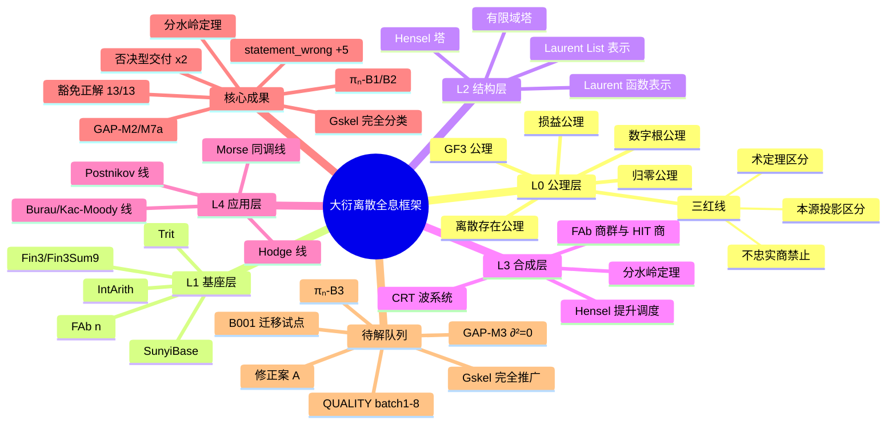

# 大衍离散全息框架——思维导图 / 大纲

## Mermaid 思维导图


## 跨线依赖（Mermaid flow）
```mermaid
flowchart TD
  L0[L0 公理层] --> L1[L1 Trit 基座]
  L1 --> GF3[GF(3)] --> GF9[GF(9)] --> GFT[有限域塔]
  L2[L2 Laurent 函数表示] --> Mat3[Mat3] --> Burau[BurauCubical]
  GFT --> Hensel[Hensel 塔]
  L3[L3 合成层：分水岭定理/CRT/Hensel 调度] --> L4[L4 应用层]
  Burau --> Kac[Burau/Kac-Moody]
  L4 --> Morse[Morse 同调]
  L4 --> Hodge[Hodge]
  L4 --> PN[Postnikov]
```

> 注：核心成果/待解队列明细见姊妹件「大衍框架-知识图谱总结.md」§七/§九。
