# 大衍框架·课题依赖 DAG

> 2026-10-13｜结构化三件配套：`课题依赖DAG.json`（AI 接口）/`课题依赖DAG.yaml`（可读）——均已解析验证
> 总图/矩阵/A1 子任务/并行批次的完整版见本文件正文（整合自五文件闭环）

## 一、总图（Mermaid）

```mermaid
flowchart TD
    subgraph L0["基座 · 已证定理（硬输入）"]
        GF3[GF3 公理]; Trit[Trit 9-case 完整]; FAb[FAb n 群律]; Laurent[Laurent 函数表示]
        Watershed[分水岭定理]; Eckmann[Eckmann GF3 不分裂]; Pi1[π₁ᵈ 定义]; PiN[πₙ-B1..B5 Ωⁿ 迭代]
        CRT[CRT 行列式降维]; Morse[Morse 边界路由]; PiDH[h₁/h₂ 离散 Hurewicz dim-1/2]
        CT1[CT 单方向]; PR[PartialRecursive 面]; MN[ab* 实例 + QuotientBasic]; Comp[紧致性失效 + TM 面]
    end
    subgraph A["A 类 · 本体论/定义层（P0 独立）"]
        A1["A1 πₙ≥2 本体论（部分建成）"]; A2["A2 修正案A与分水岭（报告✅）"]; A3["A3 E10 截断商→本身（报告✅）"]
    end
    subgraph B["B 类 · 证明策略"]
        B1["B1 Bigelow 离散路径（检索中）"]; B2["B2 CT 三模型等价（报告✅）"]; B3["B3 Myhill-Nerode 一般形（报告✅）"]
    end
    subgraph C["C 类 · 依赖链"]
        C1["C1 Trakhtenbrot 完整（前置修正=CT 机器级桥）"]
    end
    subgraph D["D 类 · 深层对接"]
        D1["D1 分水岭一般化（报告在途）"]; D2["D2 discreteHurewicz（设计✅+DH 施工✅）"]; D3["D3 Dodziuk 替代论证（报告在途）"]
    end
    subgraph E["E 类 · 外部引用标签（非课题）"]
        EBig[Bigelow n≥5]; EK10["K(E10) 32 维"]; EMcKay[一般 McKay 对应]
    end
    Laurent ==> B1; Watershed ==> A2; Watershed ==> D1; Pi1 ==> A1; PiN ==> A1; PiN ==> D2
    PiDH ==> D2; Eckmann ==> D3; CT1 ==> B2; PR ==> B2; MN ==> B3; Comp ==> C1
    A1 -.-> D2; A2 -.-> D1
    EBig -.-> B1; EK10 -.-> A3; EMcKay -.-> A3
```



## 二、课题级依赖矩阵
| 课题 | 硬依赖（已证基座） | 软依赖 | 外部标签 | 后续件 |
|---|---|---|---|---|
| A1 | π₁ᵈ 定义、πₙ-B1..B5 | — | — | D2（软）、A1a–A1d |
| A2 | 分水岭定理 | — | — | D1（相关不依赖） |
| A3 | 无 | — | K(E10) | — |
| B1 | Laurent 函数表示 | A1（不直接） | Bigelow | — |
| B2 | CT 单方向、PartialRecursive | — | — | — |
| B3 | (ab)* 实例、QuotientBasic | — | — | Counting 供给 |
| C1 | **CT 机器级桥（修正）**+TM 面 | — | — | 紧致性失效=独立经典结果 |
| D1 | 分水岭定理 | A2（相关不依赖） | — | Graphs 供给 |
| D2 | πₙ 线（DH-1..4b 已施工） | A1（软已先行） | — | — |
| D3 | Eckmann GF3 | — | — | DP 供给 |

## 三、A1 内部子任务（两串行链）
```
A1 → A1b（Ω⁴+ 机件）→ A1c（阿贝尔性）      ← 串 1
A1 → A1a（Sⁿᵈ 递归）→ A1d（临界胞腔判据）  ← 串 2
已建件：S¹ᵈ 六面/S²ᵈ 4顶6边/Ω¹≅Loop/π₂ᵈ+rec-elim/DMG-DMT/h₁-h₂
```

## 四、并行批次与关键路径
- **批 1**（A 类三件）：A1/A2/A3 全独立并行——**报告面：A2✅ A3✅，A1✅（v2 部分建成）**；
- **批 2**（B/C/D 七件）：报告面 B2/B3/C1✅（一章三份）｜B1/D1/D3 在途；
- **批 3**（A1 子任务）：A1b→A1c｜A1a→A1d 两串内部并行；
- **批 4**：D1 正式推进（A2 完成后对接——软依赖先例 DH-1..4b）。
- **关键路径**：`GF3→…→分水岭→A2→D1`｜`GF3→π₁ᵈ→πₙ→A1→A1c`｜`GF3→Laurent→B1`——**无未决断链**（每步已证或部分建成）。

## 五、线型语义
| 线型 | 含义 |
|---|---|
| 实线 ==> | 硬依赖（缺则不可做） |
| 虚线 -.-> | 软依赖（可先行施工，最终对接） |
| 点线 | 外部标签/施工供给（仅引用陈述或复用件） |

## 五.5、报告面状态（2026-10-13 同步）
| 课题 | 状态 |
|---|---|
| A1 | 设计完备（主v2+A1b+A1a 三件+施工草案；A1c 串1 在途） |
| A2/A3 | ✅ 报告（含施工批排程） |
| B1/B2/B3/C1/D1/D3 | ✅ 报告（B1 显式核元素钉实+oracle 预演；C1 前置修正=CT 机器级桥） |
| D2 | ✅ 设计+DH-1..4b 施工 |
| **实施候选（待人类 go）** | A2 三段 / A3-1（Serre-in-Mat2 速赢）/ D1-impl / B1 验证件（250-450）/ A1b 批（150-250）/ A1a 批（150-230）/ A1d 批（120-200） |

## 六、一句话
**DAG 无环（37/37 拓扑排序全消实证）**；A 类 P0 平行、B/C/D 依赖已证基座不必然依赖 A；A1 内部两串行链；最长链无未决断链——**研究报告面十课题全部落盘或收官在途**。
