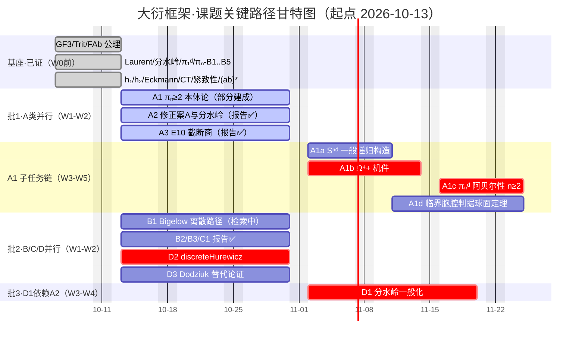

# 大衍框架·课题关键路径甘特图

> 2026-10-13｜结构化配套：`课题甘特图.json`/`.yaml`（已解析验证）｜DAG 三件（`课题依赖DAG.*`）上游

## 时间轴
| 周 | 区间 | 关键路径 | 并行 |
|---|---|---|---|
| W0 | ~10-13 | 基座全证 ✅ | — |
| W1-W2 | 10-13→10-26 | A1/A2/D2（crit） | A3/B1/B2/B3/C1/D3 |
| W3-W4 | 10-27→11-09 | A1b→A1c（crit）+D1（crit） | A1a/A1d |
| W5 | 11-10→11-16 | **A1c 收口（关键路径终点）** | 收尾 |

**总工期 ≈ 4.5 周**；最长关键路径 = `A1→A1b（Ω⁴+ 零命中瓶颈）→A1c`。

## 三条关键路径对照
| 路径 | 链 | 工期 | 决定总工期？ | 瓶颈 |
|---|---|---|---|---|
| ① 管理主线 | 分水岭→A2→D1 | 4 周 | 否 | A2 backtrack 判定 |
| ② 技术主线 | π₁ᵈ→A1→A1b→A1c | **4.5 周** | **是** | **A1b Ω⁴+ 零命中** |
| ③ 并行分支 | Laurent→B1 | 2 周 | 否 | 核元素检索 |

## 一句话
总工期 4.5 周；唯一需新工具设计的瓶颈=A1b（Ω⁴+ 机件）；无环/无未决断链/软依赖已先行（D2 与 A1 并行）。**甘特起点 2026-10-13——报告面在飞批（B1/D1/D3+施工尾件）落地后按本表滚动**。
